# PAYFLOW — Dataset Audit Report

**Project:** PAYFLOW — Digital Payments Intelligence & Trends Analysis  
**Phase:** Phase 1 — Dataset Audit & Project Setup  
**Dataset:** Reserve Bank of India (RBI) Payment System Indicators (New Format)  
**File Location:** [`data/raw/612--payment-system-indicators--new-format.csv`](file:///c:/Users/DELL/PAYFLOW/data/raw/612--payment-system-indicators--new-format.csv)  
**Audit Date:** October 2026  
**Status:** Completed  

---

## 1. Executive Summary

This audit report provides an exhaustive, forensic examination of the primary dataset provided for project **PAYFLOW**. The dataset originates from the **Reserve Bank of India (RBI)**, specifically **Table 612: "Payment System Indicators (New Format)"**, published via the RBI Database on Indian Economy (DBIE).

The dataset captures the macro-level operational evolution of India's payment and settlement infrastructure across an uninterrupted **81-month time horizon from November 2019 to July 2026**. It contains monthly aggregate volumes and values across 70 distinct payment systems, clearing mechanisms, retail transfer rails, card payment channels, cash withdrawal points, and physical acceptance infrastructures.

The file is an export of a multi-tiered spreadsheet report containing metadata wrapper columns, 4 hierarchical header levels, 81 data records, and regulatory explanatory footnotes. This audit defines the structural schema, validates data integrity, catalogues all indicators, establishes data quality anomalies, articulates viable business questions, outlines structural analytical boundaries, and lays the engineering groundwork for Phase 2 data cleaning and modeling.

---

## 2. Dataset Provenance & File Specifications

### 2.1 Source Attribution
- **Issuing Authority:** Reserve Bank of India (RBI) — Department of Payment and Settlement Systems (DPSS).
- **Publication Title:** Payment System Indicators (Table No. 612).
- **Reporting Framework:** "New Format" (introduced effective November 2019, replacing legacy formats to capture granular digital rails like FASTag/NETC, USSD, UPI QR, BBPS, and separate intra/inter-bank mobile payments).
- **Temporal Scope:** November 2019 (`Nov-2019`) through July 2026 (`Jul-2026`).
- **Data Release Frequency:** Monthly (published with approximately a 2–3 month reporting lag).
- **Regulatory Scope:** Covers all formal, domestic financial payment and settlement transactions processed through RBI, CCIL (Clearing Corporation of India Ltd.), NPCI (National Payments Corporation of India), commercial banks, and authorized non-bank PPI issuers. Failed transactions, reversals, chargebacks, and expired cards/wallets are strictly excluded (per RBI Footnote 4).

### 2.2 File Attributes
| Attribute | Specification | Notes |
| :--- | :--- | :--- |
| **File Name** | `612--payment-system-indicators--new-format.csv` | Preserved unchanged in `data/raw/` |
| **File Format** | Plain-text Comma-Separated Values (`.csv`) | Standard RFC 4180 CSV with quoted strings |
| **File Size** | 103,083 bytes (~100.67 KB) | Exact byte count on disk |
| **Character Encoding** | UTF-8 | Includes currency symbols (`Rupees Crores`) and footnote markers (`@`, `$`, `*`) |
| **Total Physical Rows** | 94 rows (1 CSV header + 93 content rows) | Multi-line footnote text in rows 90 & 92 |
| **Total Physical Columns** | 145 columns | 4 metadata + 1 Month/Year + 140 indicator columns |
| **Date Continuity** | 81 consecutive months | No missing months; strictly descending monthly sequence |

---

## 3. Structural Decomposition & Hierarchy Analysis

The CSV file exhibits a complex multi-tier structure resulting from the programmatic serialization of an official RBI hierarchical Excel publication.

```
┌────────────────────────────────────────────────────────────────────────┐
│                          CSV LAYOUT TAXONOMY                           │
├─────────┬──────────────┬───────────────────────────────────────────────┤
│ Line 0  │ CSV Header   │ src_file, tab, period, row_no, c1 ... c141    │
├─────────┼──────────────┼───────────────────────────────────────────────┤
│ Line 1  │ Metadata 1   │ Empty padding row (row_no = 1)                │
│ Line 2  │ Metadata 2   │ Report Title: "Payment System Indicators"     │
│ Line 3  │ Metadata 3   │ Empty padding row (row_no = 3)                │
├─────────┼──────────────┼───────────────────────────────────────────────┤
│ Line 4  │ Header L1    │ Major Section Classification (row_no = 4)     │
│ Line 5  │ Header L2    │ Sub-Section Classification (row_no = 5)       │
│ Line 6  │ Header L3    │ Payment Instrument / Channel (row_no = 6)     │
│ Line 7  │ Header L4    │ Unit of Measurement (Volume / Value)          │
├─────────┼──────────────┼───────────────────────────────────────────────┤
│ Line 8  │ Data Row 1   │ Jul-2026 (Most recent period, row_no = 8)     │
│  ...    │   ...        │ 81 consecutive monthly time-series records    │
│ Line 88 │ Data Row 81  │ Nov-2019 (Oldest period, row_no = 88)         │
├─────────┼──────────────┼───────────────────────────────────────────────┤
│ Line 89 │ Footnote Pad │ Empty row (row_no = 89)                       │
│ Line 90 │ Footnote 1   │ Symbol inclusions (@, $, *) (row_no = 90)     │
│ Line 91 │ Footnote Pad │ Empty row (row_no = 91)                       │
│ Line 92 │ Footnote 2   │ Methodological & comparability notes (row 92) │
│ Line 93 │ Footnote Pad │ Empty row (row_no = 93)                       │
└─────────┴──────────────┴───────────────────────────────────────────────┘
```

### 3.1 Metadata Wrapper Columns (Indices 0 to 3)
1. `src_file`: Source file identifier (`612--payment-system-indicators--new-format.csv`).
2. `tab`: Worksheet name within the workbook (`New Format`).
3. `period`: Dataset historical window flag (`full-history`).
4. `row_no`: Sequential integer row index matching the RBI spreadsheet line number (1 to 93).

### 3.2 Time Dimension Column (Index 4 / Column `c1`)
- Column `c1` contains the temporal anchor formatted as `MMM-YYYY` (e.g., `Jul-2026`, `Jun-2026`, down to `Nov-2019`).
- Chronological ordering in the raw file is **strictly reverse chronological** (newest to oldest).

### 3.3 Four-Tier Header Hierarchy (Rows 4 to 7)
Because the original Excel table utilized vertically and horizontally merged cells, the CSV export leaves empty strings in merged positions. A robust parsing pipeline must propagate non-empty headers downward and rightward:
- **Tier 1 — Major System (Row 4):**
  - Columns `c2`–`c15`: `A. Settlement Systems`
  - Columns `c16`–`c85`: `B. Payment Systems`
  - Columns `c86`–`c97`: `A. Other Payment Channels`
  - Columns `c98`–`c115`: `B. ATMs`
  - Columns `c116`–`c141`: `Payment System Infrastructures`
- **Tier 2 — Sub-Section (Row 5):**
  - Differentiates Wholesale FMIs (Financial Market Infrastructures) from Retail Systems (`II Retail`).
- **Tier 3 — Payment Instrument / Channel (Row 6):**
  - Contains formal regulatory names (e.g., `1.1 Govt. Securities Clearing`, `2.7 UPI @`, `4.1 Credit Cards`, `3 Number of ATMs`).
- **Tier 4 — Metric & Unit of Measurement (Row 7):**
  - Pairs each instrument into two contiguous columns:
    - **Volume:** Expressed in **Lakh** ($1\text{ Lakh} = 100,000\text{ units/transactions}$).
    - **Value:** Expressed in **Rupees Crores** ($1\text{ Crore} = 10,000,000\text{ INR}$).

---

## 4. Comprehensive Column Taxonomy & Dictionary

The 140 indicator columns form **70 standardized metric pairs** (Volume in Lakh + Value in INR Crores, or Physical Count in Lakh + Value placeholder).

```mermaid
flowchart TD
    RBI["RBI Payment System Indicators (140 Columns / 70 Pairs)"]
    
    RBI --> FMI["Wholesale FMIs & Settlement (10 Pairs)"]
    RBI --> Retail["Retail Payment Systems (32 Pairs)"]
    RBI --> Channels["Alternative Channels (6 Pairs)"]
    RBI --> Cash["Cash Withdrawals (10 Pairs)"]
    RBI --> Infra["Acceptance Infrastructure (12 Pairs)"]
    
    FMI --> CCIL["CCIL Clearing (c2-c15)"]
    FMI --> RTGS["RTGS Transfers (c16-c21)"]
    
    Retail --> CreditTx["Credit Transfers: UPI, NEFT, IMPS, NACH, AePS (c22-c39)"]
    Retail --> DebitTx["Debit Transfers: NACH Dr, NETC FASTag, ECS (c40-c49)"]
    Retail --> Cards["Cards: Credit & Debit PoS/Online (c50-c63)"]
    Retail --> PPI["PPIs: Wallets & Prepaid Cards (c64-c73)"]
    Retail --> Paper["Paper: CTS Cheques (c74-c79)"]
    Retail --> Totals["Macro Totals: Retail, Digital, Overall (c80-c85)"]
    
    Channels --> Mobile["Mobile Banking App (c86-c91)"]
    Channels --> Internet["Internet Banking Netbanking (c92-c97)"]
    
    Cash --> ATM["ATM Withdrawals (c98-c105)"]
    Cash --> PoSCash["PoS Cash Withdrawals (c106-c111)"]
    Cash --> MicroATM["Micro-ATM AePS Cash (c112-c115)"]
    
    Infra --> CardsBase["Cards in Force (c116-c121)"]
    Infra --> PPIBase["PPIs Issued (c122-c127)"]
    Infra --> ATMBase["ATMs & Micro-ATMs (c128-c135)"]
    Infra --> Terminals["PoS Terminals & QR Codes (c136-c141)"]
```



### Detailed Column Mapping Table

| Pair | Vol Col | Val Col | Major Section | Sub-Section | Instrument / Indicator Name | Metric Types & Units |
| :---: | :---: | :---: | :--- | :--- | :--- | :--- |
| **01** | `c2` | `c3` | A. Settlement Systems | FMIs | 1 CCIL Operated Systems (1.1 to 1.3) | Vol (Lakh), Val (₹ Cr) |
| **02** | `c4` | `c5` | A. Settlement Systems | FMIs | 1.1 Govt. Securities Clearing (1.1.1 to 1.1.3) | Vol (Lakh), Val (₹ Cr) |
| **03** | `c6` | `c7` | A. Settlement Systems | FMIs | 1.1.1 Outright | Vol (Lakh), Val (₹ Cr) |
| **04** | `c8` | `c9` | A. Settlement Systems | FMIs | 1.1.2 Repo | Vol (Lakh), Val (₹ Cr) |
| **05** | `c10` | `c11` | A. Settlement Systems | FMIs | 1.1.3 Tri-party Repo | Vol (Lakh), Val (₹ Cr) |
| **06** | `c12` | `c13` | A. Settlement Systems | FMIs | 1.2 Forex Clearing | Vol (Lakh), Val (₹ Cr) |
| **07** | `c14` | `c15` | A. Settlement Systems | FMIs | 1.3 Rupee Derivatives @ | Vol (Lakh), Val (₹ Cr) |
| **08** | `c16` | `c17` | B. Payment Systems | I FMIs | 1 Credit Transfers - RTGS (1.1 to 1.2) | Vol (Lakh), Val (₹ Cr) |
| **09** | `c18` | `c19` | B. Payment Systems | I FMIs | 1.1 Customer Transactions | Vol (Lakh), Val (₹ Cr) |
| **10** | `c20` | `c21` | B. Payment Systems | I FMIs | 1.2 Interbank Transactions | Vol (Lakh), Val (₹ Cr) |
| **11** | `c22` | `c23` | B. Payment Systems | II Retail | 2 Credit Transfers - Retail (2.1 to 2.7) | Vol (Lakh), Val (₹ Cr) |
| **12** | `c24` | `c25` | B. Payment Systems | II Retail | 2.1 AePS (Fund Transfers) @ | Vol (Lakh), Val (₹ Cr) |
| **13** | `c26` | `c27` | B. Payment Systems | II Retail | 2.2 APBS $ (Aadhaar Payment Bridge System) | Vol (Lakh), Val (₹ Cr) |
| **14** | `c28` | `c29` | B. Payment Systems | II Retail | 2.3 ECS Cr (Deprecated) | Vol (Lakh), Val (₹ Cr) |
| **15** | `c30` | `c31` | B. Payment Systems | II Retail | 2.4 IMPS | Vol (Lakh), Val (₹ Cr) |
| **16** | `c32` | `c33` | B. Payment Systems | II Retail | 2.5 NACH Cr $ | Vol (Lakh), Val (₹ Cr) |
| **17** | `c34` | `c35` | B. Payment Systems | II Retail | 2.6 NEFT | Vol (Lakh), Val (₹ Cr) |
| **18** | `c36` | `c37` | B. Payment Systems | II Retail | 2.7 UPI @ | Vol (Lakh), Val (₹ Cr) |
| **19** | `c38` | `c39` | B. Payment Systems | II Retail | 2.7.1 of which USSD @ | Vol (Lakh), Val (₹ Cr) |
| **20** | `c40` | `c41` | B. Payment Systems | II Retail | 3 Debit Transfers and Direct Debits (3.1 to 3.4) | Vol (Lakh), Val (₹ Cr) |
| **21** | `c42` | `c43` | B. Payment Systems | II Retail | 3.1 BHIM Aadhaar Pay @ | Vol (Lakh), Val (₹ Cr) |
| **22** | `c44` | `c45` | B. Payment Systems | II Retail | 3.2 ECS Dr (Deprecated) | Vol (Lakh), Val (₹ Cr) |
| **23** | `c46` | `c47` | B. Payment Systems | II Retail | 3.3 NACH Dr $ | Vol (Lakh), Val (₹ Cr) |
| **24** | `c48` | `c49` | B. Payment Systems | II Retail | 3.4 NETC (linked to bank account / FASTag) @ | Vol (Lakh), Val (₹ Cr) |
| **25** | `c50` | `c51` | B. Payment Systems | II Retail | 4 Card Payments (4.1 to 4.2) | Vol (Lakh), Val (₹ Cr) |
| **26** | `c52` | `c53` | B. Payment Systems | II Retail | 4.1 Credit Cards (4.1.1 to 4.1.2) | Vol (Lakh), Val (₹ Cr) |
| **27** | `c54` | `c55` | B. Payment Systems | II Retail | 4.1.1 PoS based $ | Vol (Lakh), Val (₹ Cr) |
| **28** | `c56` | `c57` | B. Payment Systems | II Retail | 4.1.2 Others (e-Commerce) $ | Vol (Lakh), Val (₹ Cr) |
| **29** | `c58` | `c59` | B. Payment Systems | II Retail | 4.2 Debit Cards (4.2.1 to 4.2.2) | Vol (Lakh), Val (₹ Cr) |
| **30** | `c60` | `c61` | B. Payment Systems | II Retail | 4.2.1 PoS based $ | Vol (Lakh), Val (₹ Cr) |
| **31** | `c62` | `c63` | B. Payment Systems | II Retail | 4.2.2 Others (e-Commerce) $ | Vol (Lakh), Val (₹ Cr) |
| **32** | `c64` | `c65` | B. Payment Systems | II Retail | 5 Prepaid Payment Instruments (5.1 to 5.2) | Vol (Lakh), Val (₹ Cr) |
| **33** | `c66` | `c67` | B. Payment Systems | II Retail | 5.1 Wallets | Vol (Lakh), Val (₹ Cr) |
| **34** | `c68` | `c69` | B. Payment Systems | II Retail | 5.2 Cards (5.2.1 to 5.2.2) | Vol (Lakh), Val (₹ Cr) |
| **35** | `c70` | `c71` | B. Payment Systems | II Retail | 5.2.1 PoS based $ | Vol (Lakh), Val (₹ Cr) |
| **36** | `c72` | `c73` | B. Payment Systems | II Retail | 5.2.2 Others $ | Vol (Lakh), Val (₹ Cr) |
| **37** | `c74` | `c75` | B. Payment Systems | II Retail | 6 Paper-based Instruments (6.1 to 6.2) | Vol (Lakh), Val (₹ Cr) |
| **38** | `c76` | `c77` | B. Payment Systems | II Retail | 6.1 CTS (Cheque Truncation System) | Vol (Lakh), Val (₹ Cr) |
| **39** | `c78` | `c79` | B. Payment Systems | II Retail | 6.2 Others (Non-CTS Clearing) | Vol (Lakh), Val (₹ Cr) |
| **40** | `c80` | `c81` | B. Payment Systems | II Retail | Total - Retail Payments (2+3+4+5+6) | Vol (Lakh), Val (₹ Cr) |
| **41** | `c82` | `c83` | B. Payment Systems | II Retail | Total Payments (1+2+3+4+5+6) | Vol (Lakh), Val (₹ Cr) |
| **42** | `c84` | `c85` | B. Payment Systems | II Retail | Total Digital Payments (1+2+3+4+5) | Vol (Lakh), Val (₹ Cr) |
| **43** | `c86` | `c87` | A. Other Payment Channels | II Retail | 1 Mobile Payments (mobile app based) | Vol (Lakh), Val (₹ Cr) |
| **44** | `c88` | `c89` | A. Other Payment Channels | II Retail | 1.1 Intra-bank $ | Vol (Lakh), Val (₹ Cr) |
| **45** | `c90` | `c91` | A. Other Payment Channels | II Retail | 1.2 Inter-bank $ | Vol (Lakh), Val (₹ Cr) |
| **46** | `c92` | `c93` | A. Other Payment Channels | II Retail | 2 Internet Payments (Netbanking) @ | Vol (Lakh), Val (₹ Cr) |
| **47** | `c94` | `c95` | A. Other Payment Channels | II Retail | 2.1 Intra-bank @ | Vol (Lakh), Val (₹ Cr) |
| **48** | `c96` | `c97` | A. Other Payment Channels | II Retail | 2.2 Inter-bank @ | Vol (Lakh), Val (₹ Cr) |
| **49** | `c98` | `c99` | B. ATMs | II Retail | 3 Cash Withdrawal at ATMs $ | Vol (Lakh), Val (₹ Cr) |
| **50** | `c100` | `c101` | B. ATMs | II Retail | 3.1 Using Credit Cards $ | Vol (Lakh), Val (₹ Cr) |
| **51** | `c102` | `c103` | B. ATMs | II Retail | 3.2 Using Debit Cards $ | Vol (Lakh), Val (₹ Cr) |
| **52** | `c104` | `c105` | B. ATMs | II Retail | 3.3 Using Pre-paid Cards $ | Vol (Lakh), Val (₹ Cr) |
| **53** | `c106` | `c107` | B. ATMs | II Retail | 4 Cash Withdrawal at PoS $ | Vol (Lakh), Val (₹ Cr) |
| **54** | `c108` | `c109` | B. ATMs | II Retail | 4.1 Using Debit Cards $ | Vol (Lakh), Val (₹ Cr) |
| **55** | `c110` | `c111` | B. ATMs | II Retail | 4.2 Using Pre-paid Cards $ | Vol (Lakh), Val (₹ Cr) |
| **56** | `c112` | `c113` | B. ATMs | II Retail | 5 Cash Withdrawal at Micro ATMs @ | Vol (Lakh), Val (₹ Cr) |
| **57** | `c114` | `c115` | B. ATMs | II Retail | 5.1 AePS Cash @ | Vol (Lakh), Val (₹ Cr) |
| **58** | `c116` | `c117` | Payment System Infrastructures | II Retail | 1 Number of Cards (1.1 to 1.2) | Count (Lakh), Value N/A |
| **59** | `c118` | `c119` | Payment System Infrastructures | II Retail | 1.1 Credit Cards in Force | Count (Lakh), Value N/A |
| **60** | `c120` | `c121` | Payment System Infrastructures | II Retail | 1.2 Debit Cards in Force | Count (Lakh), Value N/A |
| **61** | `c122` | `c123` | Payment System Infrastructures | II Retail | 2 Number of PPIs @ (2.1 to 2.2) | Count (Lakh), Value N/A |
| **62** | `c124` | `c125` | Payment System Infrastructures | II Retail | 2.1 Wallets @ | Count (Lakh), Value N/A |
| **63** | `c126` | `c127` | Payment System Infrastructures | II Retail | 2.2 Cards @ | Count (Lakh), Value N/A |
| **64** | `c128` | `c129` | Payment System Infrastructures | II Retail | 3 Number of ATMs (3.1 to 3.2) | Count (Lakh), Value N/A |
| **65** | `c130` | `c131` | Payment System Infrastructures | II Retail | 3.1 Bank owned ATMs $ | Count (Lakh), Value N/A |
| **66** | `c132` | `c133` | Payment System Infrastructures | II Retail | 3.2 White Label ATMs $ | Count (Lakh), Value N/A |
| **67** | `c134` | `c135` | Payment System Infrastructures | II Retail | 4 Number of Micro ATMs @ | Count (Lakh), Value N/A |
| **68** | `c136` | `c137` | Payment System Infrastructures | II Retail | 5 Number of PoS Terminals | Count (Lakh), Value N/A |
| **69** | `c138` | `c139` | Payment System Infrastructures | II Retail | 6 Bharat QR @ | Count (Lakh), Value N/A |
| **70** | `c140` | `c141` | Payment System Infrastructures | II Retail | 7 UPI QR (Static) * | Count (Lakh), Displaced Val |

---

## 5. Data Quality, Completeness & Anomaly Detection

A thorough automated audit of all 11,340 data cells ($81\text{ rows} \times 140\text{ indicator columns}$) revealed specific structural patterns and data-quality findings:

### 5.1 Cell Completeness Audit
- **Total Data Cells Evaluated:** 11,340
- **Null / Empty Strings (`""`):** `0` (100% cell population)
- **Standard Numeric Floats:** `9,844` (86.81%)
- **Dash Placeholder Characters (`" -"`):** `1,105` (9.74%)
- **Numeric Zeros (`0.00` or `0`):** `391` (3.45%)
- **Corrupted / Invalid Non-numeric Strings:** `0` (All text parses cleanly)

### 5.2 Duplicate Row & Temporal Continuity Verification
- **Unique Monthly Rows:** Exactly 81 out of 81 rows (0 duplicates).
- **Temporal Span:** Exactly 81 months from `Nov-2019` to `Jul-2026`.
- **Calendar Gap Test:** No missed months; exactly 12 months for 2020, 2021, 2022, 2023, 2024, 2025; 2 months for 2019 (Nov–Dec); 7 months for 2026 (Jan–Jul).

### 5.3 Forensic Anomaly Register

> [!WARNING] Data Quality Anomalies Identified in Raw Dataset
> 
> 1. **Infrastructure Value Placeholders (`c117`–`c139`):**  
>    Because the source Excel table repeated `Value( Rupees Crores )` in Row 7 across the entire width, the infrastructure count metrics (e.g. Number of ATMs, Cards in force) were assigned adjacent "Value" columns. These are populated with `" -"` (or `0.00`). **Action in Phase 2:** Drop redundant even-indexed infrastructure value columns.
> 
> 2. **Displaced Data in `c141` (UPI QR Value Column):**  
>    From `Jan-2024` through `Jan-2026`, column `c141` contains non-zero numeric figures (e.g., `3379.94` in Jan-2024, scaling to `7574.12` in Jan-2026). In contrast, prior to 2024 and after Jan-2026 it contains `" -"` or `0.00`. Inspection shows these numbers closely mirror the next month's UPI QR volume (`c140`). This indicates an uncorrected column displacement or cumulative adjustment in the upstream RBI reporting template.
> 
> 3. **Single Omission in `c64` (Prepaid Payment Instruments Volume - Sep-2023):**  
>    In Row 42 (`Sep-2023`), column `c64` (Total PPI Volume) contains `" -"`, while its constituent sub-channels contain valid numbers: Wallets `c66 = 4,927.10` Lakh and Cards `c68 = 1,216.07` Lakh (Sum = `6,143.17` Lakh). **Action in Phase 2:** Impute `c64` for Sep-2023 using the constituent sum.
> 
> 4. **Structural Deprecation of ECS (`c28`, `c29`, `c44`, `c45`):**  
>    Per RBI Footnote 2, Electronic Clearing Service (ECS Credit and Debit) was officially merged into NACH effective January 31, 2020. Post-January 2020, ECS volume and value drop to `0.00` or `" -"`. Any long-term direct debit analysis must treat NACH + ECS as a continuous lineage.
> 
> 5. **Delayed Introduction of Static UPI QR (`c140`):**  
>    Tracking for static UPI QR codes was introduced in September 2020 (Footnote 1: symbol `*`). The preceding 10 months (`Nov-2019` to `Aug-2020`) contain `" -"`.

---

## 6. Structural Scope & Inherent Granularity

### What the Data Represents
- **National Macroeconomic Aggregates:** Every figure represents the gross monthly transaction activity for the entire sovereign territory of India.
- **System-Level & Instrument-Level Breakdown:** Delineates retail vs. wholesale, paper vs. electronic, mobile vs. netbanking, card-present (PoS) vs. card-not-present (online/e-commerce).
- **Physical Acceptance Footprint:** Tracks physical touchpoints (bank ATMs, white-label ATMs, micro-ATMs, PoS terminals, QR codes).

### What the Data Does NOT Represent
- **No Bank-Level Entity Records:** There are no bank identifiers (e.g. HDFC, SBI, ICICI), no issuer vs. acquirer operational breakdowns.
- **No Merchant Category Codes (MCC):** No industry classification (e.g. groceries, fuel, travel, e-commerce, utilities).
- **No Geographic or Regional Hierarchy:** No state, union territory, district, city, or urban/rural tags.
- **No User / Account Demographics:** No consumer profiles, age, gender, credit scores, or income brackets.
- **No Transaction-Level Logs:** No individual transaction amounts, timestamps, P2P vs. P2M markers, or latency metrics.
- **No Failure or Operational Risk Telemetry:** Excludes technical declines, network downtimes, customer disputes, fraud chargebacks, or reversals.

---

## 7. Analytical Opportunities: Viable Business Questions

Using the available 141 columns and 81-month continuous sequence, PAYFLOW can rigorously address eight core business and macroeconomic domains:

### Domain 1: The Exponential Ascent of UPI & Retail Payments Cannibalization
- **Q1.1:** How rapidly did UPI expand its market share within total retail payments volume and value between Nov-2019 and Jul-2026?
- **Q1.2:** At what inflection point did UPI overtake traditional card and netbanking channels in transaction volume?
- **Q1.3:** Is UPI continuing to experience double-digit compound annual growth (CAGR), or has it entered an S-curve maturity phase?

### Domain 2: Average Ticket Size (ATS) Polarization
- **Formula:** $\text{Average Ticket Size (INR)} = \frac{\text{Value in Rupees Crores} \times 10,000,000}{\text{Volume in Lakh} \times 100,000} = \frac{\text{Value}}{\text{Volume}} \times 100$
- **Q2.1:** How has the ATS of UPI evolved compared to high-value rails (NEFT, RTGS) and retail electronic rails (IMPS)?
- **Q2.2:** Does the data reveal micro-transaction dominance (sub-₹1,000) in UPI versus premiumization in Credit Cards?

### Domain 3: Credit Cards vs. Debit Cards — The Spending Divergence
- **Q3.1:** While debit card issuance outnumbers credit card issuance by nearly 8:1 (`c120` vs `c118`), how does their transaction spending value compare?
- **Q3.2:** What is the structural shift between physical in-store PoS spending (`c54`, `c60`) versus e-commerce / "Other" spending (`c56`, `c62`) for credit and debit cards?

### Domain 4: The Demise of Paper-Based Clearing (CTS Cheques)
- **Q4.1:** How rapidly is Cheque Truncation System (CTS) volume declining over time?
- **Q4.2:** Despite volume contraction, has the average cheque value increased, indicating paper clearing is increasingly confined to high-value commercial transactions?

### Domain 5: Cash Withdrawal Dynamics & Digital Displacement
- **Q5.1:** Are total ATM cash withdrawal volumes (`c98`) and values (`c99`) peaking or declining as digital payments reach saturation?
- **Q5.2:** What is the relative share of cash withdrawals occurring at traditional ATMs versus rural Micro-ATMs (`c112`)?

### Domain 6: Acceptance Infrastructure Scaling (Terminals vs. QR Codes)
- **Q6.1:** How has the capital-intensive deployment of PoS terminals (`c136`) scaled compared to asset-light static UPI QR codes (`c140`)?
- **Q6.2:** What is the ratio of UPI QR codes to PoS terminals across the 2020–2026 timeline?

### Domain 7: Financial Inclusion & Aadhaar-Enabled Systems
- **Q7.1:** How have government direct benefit transfers and rural financial rails (APBS `c26`, AePS fund transfers `c24`, AePS cash withdrawals `c114`) trended over time?
- **Q7.2:** Are rural cash-out points via Micro-ATMs keeping pace with commercial banking infrastructure?

### Domain 8: Macroeconomic Resilience & Seasonality
- **Q8.1:** How severe was the payment contraction during the initial COVID-19 nationwide lockdown (April–May 2020)?
- **Q8.2:** Does digital payment spending exhibit predictable seasonal surges during India's festive quarter (October–November) and fiscal year-end (March)?

---

## 8. Explicit Analytical Boundaries (Out of Scope)

To maintain absolute data integrity and prevent speculative analysis, the following project boundaries are formally established:

| Proposed Analysis | Feasibility | Reason for Infeasibility |
| :--- | :---: | :--- |
| **Bank Market Share Ranking** | ❌ **NOT Possible** | Dataset has no bank-level dimensions (no SBI, HDFC, Axis, etc.). |
| **UPI P2P vs. P2M Split** | ❌ **NOT Possible** | Single composite UPI indicator (`c36`/`c37`) without sub-counterparty tags. |
| **State / City / Regional Adoption** | ❌ **NOT Possible** | National aggregate only; zero geographic identifiers. |
| **Merchant Category Spend (MCC)** | ❌ **NOT Possible** | No merchant or transaction categorization. |
| **Consumer Demographics / Churn** | ❌ **NOT Possible** | No customer-level records or behavioral attributes. |
| **Technical Decline & Failure Rates** | ❌ **NOT Possible** | Failed and reversed transactions are explicitly excluded by RBI. |
| **Intraday Peak Load Analysis** | ❌ **NOT Possible** | Monthly aggregation only; no daily or hourly timestamps. |
| **International Cross-Border Remittance** | ❌ **NOT Possible** | Only domestic transactions are tracked. |

---

## 9. Recommended Next Steps (Phase 2 Roadmap)

Based on the verified schema and data characteristics, the project will execute Phase 2 across the following milestones:

1. **Wide-to-Long Tidy Data Modeling (Python / Pandas):**
   - Transform the wide 145-column layout into a clean, normalized relational table.
   - Target schema dimensions: `month_date`, `year`, `month`, `major_section`, `sub_section`, `instrument_name`, `channel_type`, `volume_lakh`, `value_inr_crore`, `average_ticket_size_inr`.
2. **Cleaning & Standardization Rules:**
   - Parse `Month/Year` strings to standard ISO date objects (`YYYY-MM-01`).
   - Standardize `" -"` and string floats to numeric `float64` / `np.nan`.
   - Impute the missing Sep-2023 PPI Volume aggregate (`c64`).
   - Remove redundant infrastructure value placeholder columns (`c117`–`c139`).
   - Clean column `c141` by isolating anomalous figures and documenting data limitations.
3. **Database Schema & Storage Architecture:**
   - Export cleaned data to Parquet (`data/processed/payment_system_indicators_clean.parquet`) and CSV for high-performance querying.
   - Design normalized MySQL DDL scripts in `sql/` (Fact and Dimension tables).
4. **Validation Suite:**
   - Implement programmatic reconciliation tests ensuring sub-components sum to reported totals (`Retail Payments`, `Total Payments`, `Total Digital Payments`).
