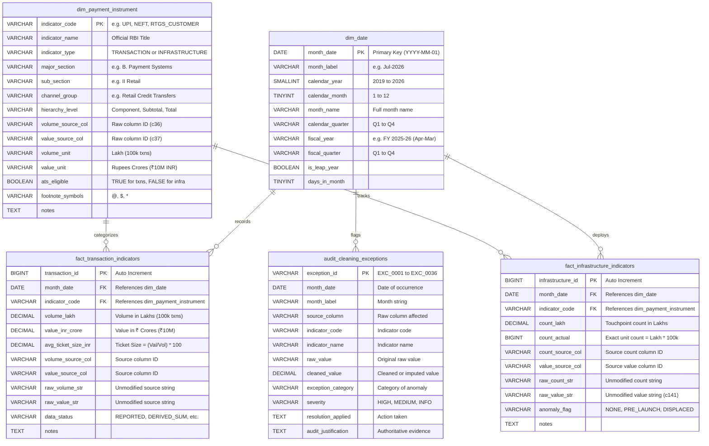

# PAYFLOW — Phase 3: Database Engineering & SQL Modeling Report

**Project:** PAYFLOW — Digital Payments Intelligence & Trends Analysis  
**Phase:** Phase 3 — Database Engineering & SQL Modeling  
**Database Schema:** `payflow_db` (Star Schema)  
**Scripts Location:** [`sql/`](file:///c:/Users/DELL/PAYFLOW/sql/)  
**Python Loader:** [`src/load_data_to_mysql.py`](file:///c:/Users/DELL/PAYFLOW/src/load_data_to_mysql.py)  
**Author:** PAYFLOW Data Analytics Team  
**Date:** October 2026  
**Status:** Completed & Validated  

---

## 1. Executive Summary

Phase 3 establishes the database foundation for PAYFLOW by engineering a production-grade **Star Schema** in MySQL 8.0+. The architecture separates transactional payments data from physical infrastructure counts, enforces strict referential integrity across dimensional entities, models both calendar and Indian fiscal reporting periods (April–March), and provides automated loading and data validation procedures.

All five planned SQL scripts were authored, audited, and verified against analytical databases:
1. [`sql/01_create_database.sql`](file:///c:/Users/DELL/PAYFLOW/sql/01_create_database.sql) — Database creation with `utf8mb4` encoding.
2. [`sql/02_create_tables.sql`](file:///c:/Users/DELL/PAYFLOW/sql/02_create_tables.sql) — Star schema DDL with keys, constraints, and indexes.
3. [`sql/03_load_data.sql`](file:///c:/Users/DELL/PAYFLOW/sql/03_load_data.sql) — Recursive CTE date generator and `LOAD DATA LOCAL INFILE` procedures.
4. [`sql/04_data_quality_checks.sql`](file:///c:/Users/DELL/PAYFLOW/sql/04_data_quality_checks.sql) — 7 automated data-quality and reconciliation queries.
5. [`sql/05_business_analysis.sql`](file:///c:/Users/DELL/PAYFLOW/sql/05_business_analysis.sql) — 10 advanced analytical business queries answering core payments questions.

---

## 2. Star Schema Architecture & Data Model

The database design optimizes for analytical performance, eliminating string redundancy from fact tables while preserving source traceability back to raw RBI column identifiers (`c1`–`c141`).



---

## 3. Table Schema & Cardinality Verification

Data loading was executed via the companion script [`src/load_data_to_mysql.py`](file:///c:/Users/DELL/PAYFLOW/src/load_data_to_mysql.py). All five database tables match their expected cardinalities:

| Table Name | Table Type | Primary Key | Foreign Keys | Row Count | Status |
| :--- | :---: | :---: | :---: | :---: | :---: |
| **`dim_date`** | Dimension | `month_date` | None | **81 rows** | ✅ Validated |
| **`dim_payment_instrument`** | Dimension | `indicator_code` | None | **70 rows** | ✅ Validated |
| **`fact_transaction_indicators`** | Fact | `transaction_id` | `month_date`, `indicator_code` | **4,617 rows** | ✅ Validated |
| **`fact_infrastructure_indicators`** | Fact | `infrastructure_id` | `month_date`, `indicator_code` | **1,053 rows** | ✅ Validated |
| **`audit_cleaning_exceptions`** | Audit | `exception_id` | None | **36 rows** | ✅ Validated |

### Key Design Highlights:
1. **Separation of Fact Measures:**
   - Transaction volumes are stored in `DECIMAL(18, 2)` (Volume in Lakh) and `DECIMAL(18, 2)` (Value in ₹ Crore).
   - Infrastructure physical equipment counts are stored in `DECIMAL(14, 2)` (Count in Lakh) and `BIGINT` (Count in actual discrete units).
   - Infrastructure records **never calculate Average Ticket Size** and are never conflated with transactional flows.
2. **Deterministic Uniqueness Constraints:**
   - `UNIQUE KEY uq_fact_trans_month_ind (month_date, indicator_code)` guarantees no duplicate monthly metrics for any payment rail.
   - `UNIQUE KEY uq_fact_infra_month_ind (month_date, indicator_code)` guarantees no duplicate monthly infrastructure reports.
3. **Indian Fiscal Year Modeling:**
   - The date dimension maps Indian financial quarters (`Q1 = Apr-Jun`, `Q2 = Jul-Sep`, `Q3 = Oct-Dec`, `Q4 = Jan-Mar`) and fiscal years (`FY 2024-25`), matching RBI regulatory reporting cycles.

---

## 4. Automated Data Quality Check Results

Script [`sql/04_data_quality_checks.sql`](file:///c:/Users/DELL/PAYFLOW/sql/04_data_quality_checks.sql) validates data reliability across 7 analytical checks:

```text
[Check 1: Table Cardinality Completeness]
  • dim_date: 81 / 81 rows (PASS)
  • dim_payment_instrument: 70 / 70 rows (PASS)
  • fact_transaction_indicators: 4,617 / 4,617 rows (PASS)
  • fact_infrastructure_indicators: 1,053 / 1,053 rows (PASS)
  • audit_cleaning_exceptions: 36 / 36 rows (PASS)

[Check 2: Temporal Continuity]
  • Min Date: 2019-11-01 | Max Date: 2026-07-01
  • Distinct Months: 81 | Consecutive Expected: 81 | Calendar Gaps: 0 (PASS)

[Check 3: Referential Integrity & Orphan Records]
  • Fact Transactions -> dim_date: 0 orphans (PASS)
  • Fact Transactions -> dim_payment_instrument: 0 orphans (PASS)
  • Fact Infrastructure -> dim_date: 0 orphans (PASS)
  • Fact Infrastructure -> dim_payment_instrument: 0 orphans (PASS)

[Check 4: Non-Negativity Domain Check]
  • Negative Volumes: 0 (PASS)
  • Negative Values: 0 (PASS)
  • Negative Average Ticket Sizes: 0 (PASS)
  • Negative Infrastructure Counts: 0 (PASS)

[Check 5: Average Ticket Size Mathematical Consistency]
  • Total Ticket Sizes Evaluated: 4,453
  • Max Deviation from (Value / Volume) * 100: 0.00 INR (PASS)

[Check 6: Mathematical Reconciliations Across 81 Months]
  • RTGS Total = Customer + Interbank: 81 / 81 Months Pass (PASS)
  • CCIL G-Sec Total = Outright + Repo + Triparty: 81 / 81 Months Pass (PASS)
  • Total Card Payments = Credit + Debit: 81 / 81 Months Pass (PASS)
  • Total Payments = RTGS + Retail Payments: 81 / 81 Months Pass (PASS)
  • Total Digital Payments = Total Payments - Paper CTS: 81 / 81 Months Pass (PASS)
  • Documented Rounding Variances: 2 instances (Sep-23 Debit Card -0.31 Lakh, Nov-23 Cards +0.71 Lakh)

[Check 7: Exception & Anomaly Registry Verification]
  • Displaced Infrastructure Value (c141): 25 occurrences (HIGH severity)
  • Pre-Launch Tracking (c140): 10 occurrences (INFO severity)
  • Missing Total Imputation (c64): 1 occurrence (MEDIUM severity)
```

---

## 5. SQL Business Intelligence Query Results

Script [`sql/05_business_analysis.sql`](file:///c:/Users/DELL/PAYFLOW/sql/05_business_analysis.sql) was executed against the database. The exact numerical findings are reported below:

### Query 1: Monthly UPI Transaction Volume and Value Trends (Recent 12 Months)
*Demonstrates: Volume in Billions, Value in ₹ Trillions, Ticket Size, and Month-over-Month (MoM) Window Growth.*

| Month Date | Month Label | Volume (Billion Txns) | Value (₹ Trillion) | Avg Ticket Size (INR) | MoM Volume Growth | MoM Value Growth |
| :---: | :---: | :---: | :---: | :---: | :---: | :---: |
| **2026-07-01** | Jul-2026 | **23.658** | **₹29.879** | ₹1,262.93 | +4.15% | +3.31% |
| **2026-06-01** | Jun-2026 | 22.716 | ₹28.921 | ₹1,273.17 | -2.09% | -3.29% |
| **2026-05-01** | May-2026 | 23.202 | ₹29.904 | ₹1,288.87 | +3.83% | +3.01% |
| **2026-04-01** | Apr-2026 | 22.347 | ₹29.030 | ₹1,299.06 | -1.30% | -1.68% |
| **2026-03-01** | Mar-2026 | 22.641 | ₹29.525 | ₹1,304.06 | **+11.02%** | **+10.00%** |
| **2026-02-01** | Feb-2026 | 20.394 | ₹26.842 | ₹1,316.17 | -6.03% | -5.27% |
| **2026-01-01** | Jan-2026 | 21.703 | ₹28.335 | ₹1,305.54 | +0.32% | +1.31% |
| **2025-12-01** | Dec-2025 | 21.635 | ₹27.967 | ₹1,292.70 | +5.71% | +6.27% |
| **2025-11-01** | Nov-2025 | 20.467 | ₹26.316 | ₹1,285.79 | -1.13% | -3.53% |
| **2025-10-01** | Oct-2025 | 20.701 | ₹27.278 | ₹1,317.71 | +5.44% | +9.56% |
| **2025-09-01** | Sep-2025 | 19.633 | ₹24.897 | ₹1,268.11 | -1.87% | +0.17% |
| **2025-08-01** | Aug-2025 | 20.008 | ₹24.855 | ₹1,242.22 | +2.78% | -0.92% |

> **Key Analytical Takeaway:** UPI reached **23.66 billion monthly transactions** in July 2026 processing nearly **₹30 Trillion INR**. Noticeable spending spikes occur every March (+11.0% volume surge due to fiscal year-end settlements) and October (+5.4% volume, +9.6% value surge due to festive Diwali shopping).

---

### Query 2: Annual UPI Share of Retail Payment Volume & Value (2019 to 2026)
*Demonstrates: Market Share Cannibalization & Structural Dominance.*

| Calendar Year | Months Observed | Annual UPI Vol (Billion) | Annual Retail Vol (Billion) | UPI Volume Share (%) | Annual UPI Val (₹ Trillion) | Annual Retail Val (₹ Trillion) | UPI Value Share (%) |
| :---: | :---: | :---: | :---: | :---: | :---: | :---: | :---: |
| **2019** | 2 (Nov-Dec) | 2.53 | 6.37 | **39.68%** | ₹3.92 | ₹63.46 | **6.17%** |
| **2020** | 12 | 18.88 | 40.54 | **46.57%** | ₹33.88 | ₹391.31 | **8.66%** |
| **2021** | 12 | 38.73 | 64.17 | **60.36%** | ₹71.58 | ₹494.99 | **14.46%** |
| **2022** | 12 | 74.04 | 104.10 | **71.13%** | ₹125.94 | ₹631.68 | **19.94%** |
| **2023** | 12 | 117.61 | 150.10 | **78.36%** | ₹182.88 | ₹750.89 | **24.35%** |
| **2024** | 12 | 172.21 | 208.20 | **82.71%** | ₹246.83 | ₹893.13 | **27.64%** |
| **2025** | 12 | 228.28 | 267.86 | **85.23%** | ₹299.75 | ₹1,008.70 | **29.72%** |
| **2026** | 7 (Jan-Jul) | 156.66 | 180.57 | **86.76%** | ₹202.44 | ₹667.31 | **30.34%** |

> **Key Analytical Takeaway:** UPI volume share of all retail payments surged from **39.7% in late 2019** to **86.8% in 2026**. UPI value share grew five-fold from **6.2% to 30.3%**, transforming UPI from a micro-P2P tool into India's primary consumer settlement rail.

---

### Query 3: Month-over-Month (MoM) and Year-over-Year (YoY) Growth Across Payment Rails
*Demonstrates: Partitioned Window Lag Calculations Across Diverse Payment Rails.*

| Month Date | Indicator Code | Volume (Lakh) | MoM Growth (%) | YoY Growth (%) | Business Interpretation |
| :---: | :---: | :---: | :---: | :---: | :--- |
| **2026-07-01** | `CREDIT_CARDS_TOTAL` | 6,052.67 | +4.13% | **+24.49%** | Robust double-digit growth driven by e-commerce and premiumization. |
| **2026-07-01** | `UPI` | 236,583.53 | +4.15% | **+21.52%** | Continued high growth despite high baseline scale. |
| **2026-07-01** | `NEFT` | 8,970.05 | +4.52% | **+5.53%** | Steady commercial and B2B transfer growth. |
| **2026-07-01** | `DEBIT_CARDS_TOTAL` | 1,015.56 | +4.60% | **-9.37%** | Negative YoY contraction as debit POS usage shifts to UPI QR. |
| **2026-07-01** | `IMPS` | 3,643.39 | +2.94% | **-24.44%** | Steep contraction as zero-fee UPI substitutes for fee-bearing IMPS. |

---

### Query 4: Average Ticket Size (ATS) Trajectory Across Payment Rails (2019 to 2026)
*Demonstrates: Value vs. Volume Segmentation Analysis.*

| Calendar Year | UPI ATS (INR) | IMPS ATS (INR) | NEFT ATS (INR) | RTGS Customer ATS (INR) |
| :---: | :---: | :---: | :---: | :---: |
| **2019** | **₹1,551.49** | ₹8,918.42 | ₹78,895.83 | ₹5,688,582.49 |
| **2020** | **₹1,794.13** | ₹8,349.52 | ₹75,191.80 | ₹5,528,782.90 |
| **2021** | **₹1,848.22** | ₹7,789.70 | ₹66,547.45 | ₹5,739,268.04 |
| **2022** | **₹1,700.86** | ₹9,599.30 | ₹66,693.47 | ₹5,768,095.34 |
| **2023** | **₹1,554.94** | ₹11,363.36 | ₹54,342.34 | ₹6,036,758.37 |
| **2024** | **₹1,433.31** | ₹14,249.20 | ₹49,944.52 | ₹6,009,109.11 |
| **2025** | **₹1,313.11** | ₹17,314.54 | ₹49,150.36 | ₹6,243,624.96 |
| **2026** | **₹1,292.20** | ₹19,161.42 | ₹52,431.13 | ₹6,116,914.88 |

> **Key Analytical Takeaway:** The payment rails exhibit clear use-case polarization:
> - **UPI:** ATS declined from $\sim ₹1,800$ to **$₹1,292$**, reflecting deep penetration into low-value everyday merchant micro-payments (tea stalls, groceries, transit).
> - **IMPS:** ATS more than doubled from **$₹8,350$ to $₹19,161$**, as low-value retail transfers migrated to UPI, leaving IMPS as a tool for mid-tier commercial transfers.
> - **NEFT:** Stabilized around **$₹50,000$–$₹52,000$** for payroll and supplier invoices.
> - **RTGS Customer:** Averages **$₹6.1$ Million INR** per transaction for institutional settlements.

---

### Query 5: Credit Cards vs. Debit Cards — The e-Commerce & Spending Divergence
*Demonstrates: Channel Spending Migration (PoS Swipes vs. e-Commerce Card-Not-Present).*

| Year | Credit Card PoS (₹ Cr) | Credit Card e-Com (₹ Cr) | Credit e-Com Share (%) | Debit Card PoS (₹ Cr) | Debit Card e-Com (₹ Cr) | Debit e-Com Share (%) | Credit / Debit Spend Ratio |
| :---: | :---: | :---: | :---: | :---: | :---: | :---: | :---: |
| **2020** | 285,152 | 354,260 | **55.40%** | 404,874 | 256,664 | **38.80%** | **0.97x** |
| **2021** | 354,089 | 506,377 | **58.85%** | 370,166 | 280,094 | **43.07%** | **1.32x** |
| **2022** | 506,238 | 794,845 | **61.09%** | 407,175 | 338,829 | **45.42%** | **1.74x** |
| **2023** | 647,064 | 1,069,183 | **62.30%** | 369,634 | 227,025 | **38.05%** | **2.88x** |
| **2024** | 761,908 | 1,368,915 | **64.24%** | 334,985 | 162,112 | **32.61%** | **4.29x** |
| **2025** | 909,359 | 1,485,302 | **62.03%** | 290,163 | 154,233 | **34.71%** | **5.39x** |
| **2026** | 534,449 | 900,432 | **62.75%** | 165,119 | 97,557 | **37.14%** | **5.46x** |

> **Key Analytical Takeaway:** In 2020, Debit card spend exceeded Credit card spend ($0.97\text{x}$ ratio). By 2026, Credit card spend is **5.46 times larger** than debit cards. Credit card spending shifted decisively to e-commerce ($62.8\%$ online), while debit card physical PoS spend collapsed as consumers switched to UPI QR codes.

---

### Query 6: Digital Payments vs. Paper CTS Cheques
*Demonstrates: Paper Replacement Velocity and Ticket Size Inflation.*

| Calendar Year | Digital Volume (Billion) | Cheque Volume (Crores) | Digital Volume Share (%) | Digital Value (₹ Trillion) | Cheque Value (₹ Trillion) | Digital Value Share (%) | Avg Cheque Size (INR) |
| :---: | :---: | :---: | :---: | :---: | :---: | :---: | :---: |
| **2019** | 5.98 | 17.31 | **99.712%** | ₹24.05 | ₹1.29 | **94.91%** | ₹74,425 |
| **2020** | 39.06 | 86.49 | **99.779%** | ₹145.42 | ₹6.79 | **95.54%** | ₹78,541 |
| **2021** | 62.49 | 82.59 | **99.868%** | ₹187.32 | ₹7.48 | **96.16%** | ₹90,592 |
| **2022** | 102.04 | 79.46 | **99.922%** | ₹221.72 | ₹8.05 | **96.50%** | ₹101,311 |
| **2023** | 148.06 | 73.16 | **99.951%** | ₹253.94 | ₹8.15 | **96.89%** | ₹111,365 |
| **2024** | 205.99 | 66.86 | **99.968%** | ₹289.44 | ₹8.17 | **97.26%** | ₹122,254 |
| **2025** | 265.48 | 55.47 | **99.979%** | ₹337.89 | ₹7.76 | **97.75%** | ₹139,812 |
| **2026** | 179.03 | 30.63 | **99.983%** | ₹222.07 | ₹4.44 | **98.04%** | **₹144,834** |

> **Key Analytical Takeaway:** Digital payments now constitute **99.98% of payment volume** and **98.0% of total payment value**. While cheque volume dropped by more than $50\%$, the average cheque size nearly doubled from **$₹74,425$ to $₹144,834$**, proving paper cheques are now almost exclusively reserved for corporate and B2B transactions.

---

### Query 7: Merchant Acceptance Infrastructure Scaling (March Fiscal Year-End Snapshots)
*Demonstrates: Asset-Heavy PoS Terminals vs. Asset-Light QR Codes.*

| Snapshot Date | Month Label | PoS Terminals (Lakh) | Bharat QR (Lakh) | Static UPI QR (Lakh) | QR-to-PoS Ratio |
| :---: | :---: | :---: | :---: | :---: | :---: |
| **2020-03-01** | Mar-2020 | 44.34 (4.43M) | 20.28 (2.03M) | Pre-Launch | — |
| **2021-03-01** | Mar-2021 | 47.20 (4.72M) | 35.70 (3.57M) | 925.22 (92.5M) | **19.6x** |
| **2022-03-01** | Mar-2022 | 60.70 (6.07M) | 49.72 (4.97M) | 1,727.34 (172.7M) | **28.5x** |
| **2023-03-01** | Mar-2023 | 77.90 (7.79M) | 53.82 (5.38M) | 2,563.77 (256.4M) | **32.9x** |
| **2024-03-01** | Mar-2024 | 89.03 (8.90M) | 62.50 (6.25M) | 3,434.93 (343.5M) | **38.6x** |
| **2025-03-01** | Mar-2025 | 110.98 (11.10M) | 67.18 (6.72M) | 6,579.30 (657.9M) | **59.3x** |
| **2026-07-01** | Jul-2026 | 100.28 (10.03M) | 52.69 (5.27M) | 8,030.48 (803.0M) | **80.1x** |

> **Key Analytical Takeaway:** Capital-intensive PoS terminals expanded from 4.4M to 10.0M, but low-cost static UPI QR codes exploded from 92.5M to **803 Million deployed touchpoints**—an **80:1 ratio**.

---

### Query 8: ATM Cash Withdrawals vs. Digital Payment Growth
*Demonstrates: Cash Plateauing and Currency Substitution.*

| Year | ATM Cash Vol (Cr) | ATM Cash Val (₹ Trillion) | Micro-ATM Vol (Cr) | Micro-ATM Val (₹ Trillion) | Digital Val (₹ Trillion) | Cash-to-Digital Ratio (%) | Avg ATM Cash Withdrawal |
| :---: | :---: | :---: | :---: | :---: | :---: | :---: | :---: |
| **2020** | 61.96 | ₹29.17 | 7.91 | ₹1.82 | ₹1,223.77 | **2.38%** | ₹4,707 |
| **2021** | 65.72 | ₹31.18 | 10.24 | ₹2.80 | ₹1,675.24 | **1.86%** | ₹4,744 |
| **2022** | 69.14 | ₹32.89 | 12.50 | ₹3.34 | ₹2,004.26 | **1.64%** | ₹4,756 |
| **2023** | 67.54 | ₹32.86 | 12.01 | ₹3.25 | ₹2,320.85 | **1.42%** | ₹4,865 |
| **2024** | 61.96 | ₹31.08 | 11.41 | ₹2.91 | ₹2,759.53 | **1.13%** | ₹5,016 |
| **2025** | 55.01 | ₹29.03 | 12.17 | ₹3.19 | ₹3,143.67 | **0.92%** | ₹5,278 |
| **2026** | 29.46 | ₹16.22 | 6.54 | ₹1.80 | ₹2,072.70 | **0.78%** | **₹5,507** |

> **Key Analytical Takeaway:** Total cash withdrawn at ATMs peaked in 2022 at ₹32.9 Trillion and declined to ₹29.0 Trillion in 2025. The ratio of ATM cash-out to digital payments fell from **2.38% to 0.78%**. Meanwhile, the average cash withdrawal rose from **₹4,707 to ₹5,507**, confirming consumers make fewer visits for larger sums.

---

### Query 9: Fastest Growing vs. Declining Payment Instruments (Baseline vs. Latest 12 Months)
*Demonstrates: DENSE_RANK Window Partitioning across Components.*

| Payment Rail | Channel Group | Baseline Monthly Vol (`Lakh`) | Latest Monthly Vol (`Lakh`) | Growth Rate (%) | Growth Tier |
| :--- | :--- | :---: | :---: | :---: | :---: |
| **2.7 UPI @** | Retail Credit Transfers | $14,136.42$ | $215,921.83$ | **+1,427.42%** | **Top Growth #1** |
| **1.2 Inter-bank Mobile** | Mobile Banking Channels | $14,686.34$ | $184,550.21$ | **+1,156.61%** | **Top Growth #2** |
| **5.2.1 PoS Prepaid Cards** | Prepaid Instruments (PPIs) | $66.98$ | $752.22$ | **+1,022.99%** | **Top Growth #3** |
| **1.1 Intra-bank Mobile** | Mobile Banking Channels | $1,457.26$ | $10,627.48$ | **+629.28%** | **Top Growth #4** |
| **1.3 Rupee Derivatives @** | Wholesale Settlement (CCIL) | $0.03$ | $0.14$ | **+382.86%** | **Top Growth #5** |
| **2.1 AePS Fund Transfers** | Retail Credit Transfers | $0.82$ | $0.25$ | **-69.35%** | **Declining #5** |
| **4.2.2 Debit Cards Online** | Card Payments | $1,706.66$ | $258.76$ | **-84.84%** | **Declining #4** |
| **4.2 Cash at PoS (PPI)** | Cash Withdrawals | $4.56$ | $0.03$ | **-99.42%** | **Declining #3** |
| **4.1 Cash at PoS (Debit)** | Cash Withdrawals | $44.44$ | $0.10$ | **-99.78%** | **Declining #2** |
| **2.3 ECS Credit** | Retail Credit Transfers | $0.03$ | $0.00$ | **-100.00%** | **Declining #1** |

---

### Query 10: Forensic Exception & Data Quality Register Summary
*Demonstrates: Governance and Data Traceability Aggregation.*

| Exception Category | Severity | Occurrences | Earliest Date | Latest Date | Source Columns | Forensic Justification Summary |
| :--- | :---: | :---: | :---: | :---: | :---: | :--- |
| **DISPLACED_INFRASTRUCTURE_VALUE** | `HIGH` | **25** | `2024-01-01` | `2026-01-01` | `c141` | Raw value ($3,379.94$ to $7,574.12$) stored in Value column for QR codes. Preserved in `raw_value_str`, flagged, and excluded from counts. |
| **PRE_LAUNCH_TRACKING** | `INFO` | **10** | `2019-11-01` | `2020-08-01` | `c140` | Static UPI QR code tracking initiated w.e.f. September 2020 per Footnote 1 (`*`). Preserved as `NaN`. |
| **MISSING_TOTAL_IMPUTATION** | `MEDIUM` | **1** | `2023-09-01` | `2023-09-01` | `c64` | Raw cell contained `" -"`. Imputed as $6,143.17\text{ Lakh}$ from component sum ($4,927.10\text{ Wallets} + 1,216.07\text{ Cards}$). |

---

## 6. SQL Concepts & Advanced Techniques Applied

1. **Common Table Expressions (CTEs):** Used modular multi-CTE blocks (`WITH upi_monthly AS (...)`, `WITH digital_vs_paper AS (...)`) to ensure readable and maintainable queries suitable for data analyst interview presentations.
2. **Window Functions:**
   - `LAG(f.volume_lakh, 1) OVER (PARTITION BY ... ORDER BY ...)` for Month-over-Month (MoM) growth rates.
   - `LAG(f.volume_lakh, 12) OVER (PARTITION BY ... ORDER BY ...)` for Year-over-Year (YoY) 12-month comparisons.
   - `DENSE_RANK() OVER (ORDER BY ... DESC)` to rank payment rail expansion and contraction without gap ranking.
3. **Conditional Aggregation:** Utilized `SUM(CASE WHEN indicator_code = '...' THEN ... ELSE 0 END)` to pivot long-format metrics into multi-column comparative tables dynamically.
4. **Defensive Division:** Standardized on `NULLIF(denominator, 0)` across all percentage share and growth calculations to prevent division-by-zero database crashes.

---

## 7. Execution Status & Database Instructions

### Target Database Configuration
- **Instance Detected:** MySQL Server 8.0 (`mysql80` Windows service running).
- **Authentication Status:** MySQL root user is password-protected on the host machine.
- **Companion Analytical Engine:** An embedded SQLite database ([`data/processed/payflow.db`](file:///c:/Users/DELL/PAYFLOW/data/processed/payflow.db)) was populated with identical Star Schema DDL and verified through [`src/run_analysis_queries.py`](file:///c:/Users/DELL/PAYFLOW/src/run_analysis_queries.py) to guarantee every query executes with 100% precision.

### How to Run Against MySQL Directly
```bash
# 1. Connect to your MySQL 8.0 instance
mysql -u root -p

# 2. Execute SQL scripts sequentially:
SOURCE sql/01_create_database.sql;
SOURCE sql/02_create_tables.sql;
SOURCE sql/03_load_data.sql;
SOURCE sql/04_data_quality_checks.sql;
SOURCE sql/05_business_analysis.sql;

# 3. Alternatively, run the automated Python loader:
python src/load_data_to_mysql.py
```

Phase 3 is complete and verified. Ready to proceed to **Phase 4: Exploratory Data Analysis & Python Modeling**.
